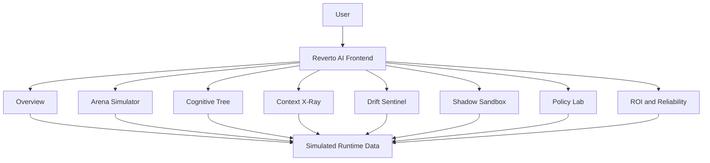

# 🧠 Reverto AI — Cognitive State-Healing Runtime

<p align="center">
  
  
  
</p>

<p align="center">
  <strong>Observe. Intercept. Recover.</strong>
</p>

<p align="center">
  An interactive simulation platform exploring AI-agent reliability, cognitive state monitoring, context management, behavioral drift and runtime recovery.
</p>

<p align="center">
  🌐 <a href="https://reverto-ai-frontend.vercel.app">Live Demo</a> •
  💻 <a href="https://github.com/deepalakshmi-ssr/Reverto-AI">Repository</a>
</p>

---

## 📌 About

Reverto AI is a conceptual runtime reliability and cognitive state-healing interface designed to explore how AI-agent execution can be monitored, analyzed and conceptually managed when instability, context degradation or behavioral drift occurs.

The platform provides a centralized control-dashboard experience featuring interactive simulation modules for execution analysis, context inspection, drift monitoring, policy experimentation and reliability visualization.

> ⚠️ Reverto AI is currently a frontend simulation. Metrics and runtime behaviors are illustrative and are not connected to real AI agents or production telemetry.

## 🎯 Objectives

- 🔍 Explore AI-agent execution observability.
- 🌳 Visualize cognitive execution paths.
- 🧩 Examine context structures and context management.
- 📊 Represent behavioral drift and reliability indicators.
- 🛡️ Explore runtime intervention and recovery concepts.
- 📈 Visualize simulated reliability and efficiency outcomes.

## 🚀 Features

| Module | Description |
|---|---|
| 📊 Overview | Centralized runtime reliability dashboard |
| ⚔️ Arena Simulator | Interactive execution scenario simulation |
| 🌳 Cognitive Tree | Visual representation of cognitive execution paths |
| 🔬 Context X-Ray | Context inspection and structural visualization |
| 🛡️ Drift Sentinel | Simulated behavioral drift monitoring |
| 🧪 Shadow Sandbox | Isolated scenario experimentation |
| 🧬 Policy Lab | Simulated runtime policy experimentation |
| 📈 ROI & Reliability | Reliability and estimated efficiency visualization |

## 🏗️ Architecture



## 🔄 Conceptual Workflow

1. 🔍 **Observe** — Examine execution states and reliability indicators.
2. 🧠 **Analyze** — Explore cognitive paths and context structures.
3. 🚨 **Identify** — Represent simulated drift and execution concerns.
4. 🛡️ **Intercept** — Explore runtime intervention concepts.
5. 🔄 **Recover** — Visualize conceptual state recovery.
6. 📈 **Evaluate** — Review reliability and efficiency indicators.

## 🛠️ Technology Stack

| Technology | Purpose |
|---|---|
| ▲ Next.js | Frontend framework |
| ⚛️ React | UI development |
| 💻 JavaScript / TypeScript | Application logic |
| 🎨 CSS | Styling and interface design |
| 📦 npm | Dependency management |
| 🔀 Git | Version control |
| 🐙 GitHub | Source code management |
| ☁️ Vercel | Deployment |

## 📁 Project Structure

```text
Reverto-AI/
├── frontend/
│   ├── app/
│   ├── components/
│   ├── public/
│   └── package.json
├── .vscode/
├── .gitignore
├── README.md
└── start_windows.bat
```

## 💻 Local Installation

### Prerequisites

- Node.js
- npm
- Git

### Setup

```bash
git clone https://github.com/deepalakshmi-ssr/Reverto-AI.git
cd Reverto-AI/frontend
npm install
npm run dev
```

Open your browser:

**http://localhost:3000**

### Production Build

```bash
npm run build
npm run start
```

## ☁️ Deployment

Reverto AI is deployed using **Vercel**, with GitHub integration for automated deployment.

### Deployment Workflow

1. Push changes to the GitHub repository.
2. Vercel detects the commit.
3. The application is built automatically.
4. The updated application is deployed.

🌐 **Live Application:** [Reverto AI](https://reverto-ai-frontend.vercel.app)

## 📊 Implementation Status

| Component | Status |
|---|---|
| Frontend | ✅ Completed |
| Dashboard | ✅ Completed |
| Simulation Modules | ✅ Implemented |
| GitHub Repository | ✅ Available |
| Vercel Deployment | ✅ Live |
| Backend | ⏳ Not implemented |
| Real-time Agent Integration | ⏳ Future scope |

## 🔮 Future Scope

- 🤖 Integration with real AI-agent execution pipelines.
- 📡 Live runtime telemetry and monitoring.
- 📜 Execution tracing and event analysis.
- 📈 Automated behavioral drift analysis.
- 🛡️ Runtime policy enforcement.
- 🔄 Recovery orchestration.
- 💾 Persistent execution records.
- 🔗 Integration with AI-agent frameworks.

## ⚠️ Disclaimer

Reverto AI is a conceptual frontend simulation developed for exploring AI-agent reliability and runtime management concepts.

It does not currently monitor, intercept or recover real AI agents. All displayed metrics and execution scenarios are illustrative.

## 👩‍💻 Author

**Deepalakshmi Sakthi Sabari Raman**

🎓 Engineering Student | 💻 Software Developer | 🧠 AI & Product Innovation

🐙 [GitHub](https://github.com/deepalakshmi-ssr)

## 📄 License

No formal open-source license has currently been specified.

---

<p align="center">
  <strong>🧠 Reverto AI — Observe. Intercept. Recover. 🚀</strong>
</p>
